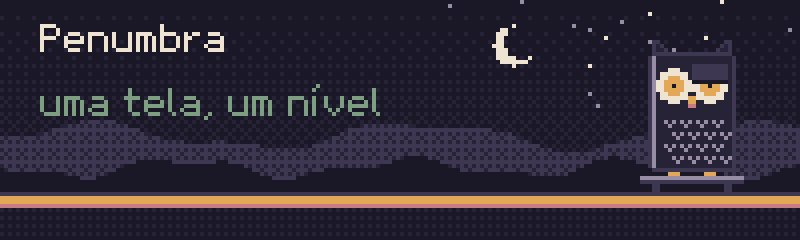
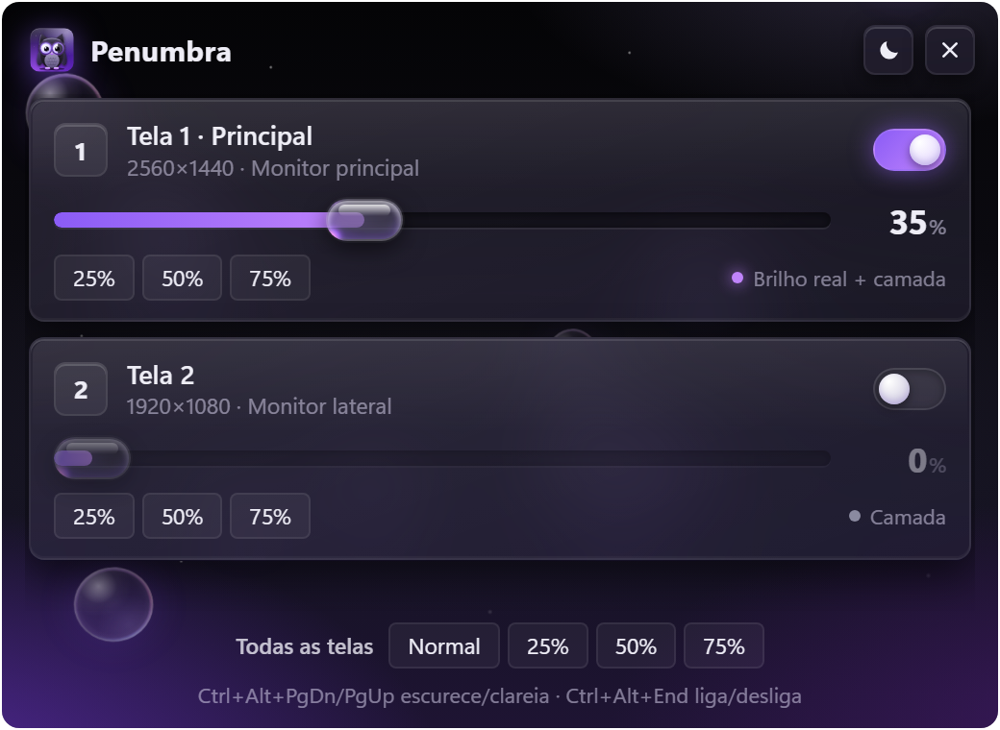

<p align="center">
  
</p>

<p align="center">
  <b>Escurece cada monitor separadamente no Windows 11.</b><br>
  Um app de bandeja em Tauri e Rust que junta o brilho real do monitor (DDC/CI) com uma camada escura por cima da tela.
</p>

<p align="center">
  <a href="#como-rodar">Como rodar</a> ·
  <a href="docs/README.md">Documentação</a> ·
  <a href="docs/como-escurece.md">Como escurece</a> ·
  <a href="https://eduardohenrique-nu.vercel.app">Portfólio</a>
</p>

<p align="center"></p>

<p align="center">
  
</p>

<p align="center"><sub>A captura usa monitores de exemplo, gerados pela própria interface fora do app.</sub></p>

## O que é

O Windows ajusta o brilho de um monitor por vez só em notebook, e o filtro de luz noturna vale para todas as telas juntas. O Penumbra dá um controle para cada tela, do 0 ao 90%:

- **Brilho real + camada.** Em monitores com DDC/CI, o brilho do próprio monitor cai até a metade (nível 50). Daí em diante, uma camada preta transparente completa o resto. Sem DDC/CI, só a camada. O nível 90 sempre deixa cerca de 10% de luz.
- **Leve.** Com a janela fechada, o app inteiro fica em cerca de 16 MB de RAM e 0% de CPU: a interface (WebView2) só existe enquanto a janela está aberta, e as camadas são janelas Win32 nativas, sem navegador.
- **Na bandeja.** Clique no ícone para abrir. O botão direito traz "Escurecer todas" (25, 50 e 75%), "Restaurar todas", "Iniciar com o Windows" e "Sair". Ao sair, brilho e camadas voltam ao normal.
- **Atalhos globais** para escurecer, clarear e ligar ou desligar tudo sem abrir a janela.
- **Dois temas:** Noite (preto, cinza e roxo, o padrão) e Aurora (azul-violeta).

### Atalhos

| Atalho | Ação |
| --- | --- |
| Ctrl+Alt+PageDown | escurece todas as telas em 10% |
| Ctrl+Alt+PageUp | clareia todas as telas em 10% |
| Ctrl+Alt+End | liga ou desliga tudo (lembra os níveis) |

## Como rodar

Precisa de Windows 10 ou 11, Node 22+, Rust estável e o Visual Studio Build Tools (C++).

```bash
git clone https://github.com/eduardohenrique-dev/penumbra.git
cd penumbra
npm install
npx tauri dev
```

Para gerar o instalador:

```bash
npx tauri build
```

O instalador NSIS sai em `src-tauri/target/release/bundle/nsis`. Rode-o pelo Explorer (duplo clique). O passo a passo completo está em [instalação e uso](docs/instalacao-e-uso.md).

## Testes

```bash
cd src-tauri
cargo test --lib
```

Os testes cobrem a divisão entre brilho real e camada, o arredondamento dos níveis, a configuração salva e a enumeração de monitores. Há também testes manuais, que escurecem as telas de verdade por alguns segundos; veja [desenvolvimento](docs/desenvolvimento.md).

## Como é por dentro

```
src-tauri/src/
  levels.rs     nível → brilho DDC/CI + opacidade da camada (funções puras)
  state.rs      configuração salva em JSON
  monitors.rs   enumeração dos monitores (Win32)
  overlay.rs    camadas: janelas Win32 click-through, uma por monitor
  ddc.rs        brilho real pelo DDC/CI (dxva2)
  core.rs       junta tudo; debounce do DDC e da gravação
  lib.rs        bandeja, janela sob demanda, instância única, atalhos
ui/             interface em HTML, CSS e JS puro (liquid glass)
branding/       logo da coruja e scripts dos ícones
```

A visão completa está em [arquitetura](docs/arquitetura.md).

## Documentação

- [Instalação e uso](docs/instalacao-e-uso.md)
- [Como escurece](docs/como-escurece.md)
- [Arquitetura](docs/arquitetura.md)
- [Desenvolvimento](docs/desenvolvimento.md)

## Coletânea Quintal

O Penumbra faz parte do Quintal, três apps de Windows com a mesma família visual: cada um tem um bicho e uma cor. A coruja violeta é o Penumbra; o porquinho rosa é o [Acervo](https://github.com/eduardohenrique-dev/acervo); o gato preto em âmbar é o [Palco](https://github.com/eduardohenrique-dev/palco).

## Limitações

- Jogos em tela cheia exclusiva podem ficar por cima da camada escura.
- Alguns monitores e telas de notebook não aceitam DDC/CI: nesses, só a camada.

---

<sub>Feito em Governador Valadares (MG). Código publicado para consulta; todos os direitos reservados.</sub>
